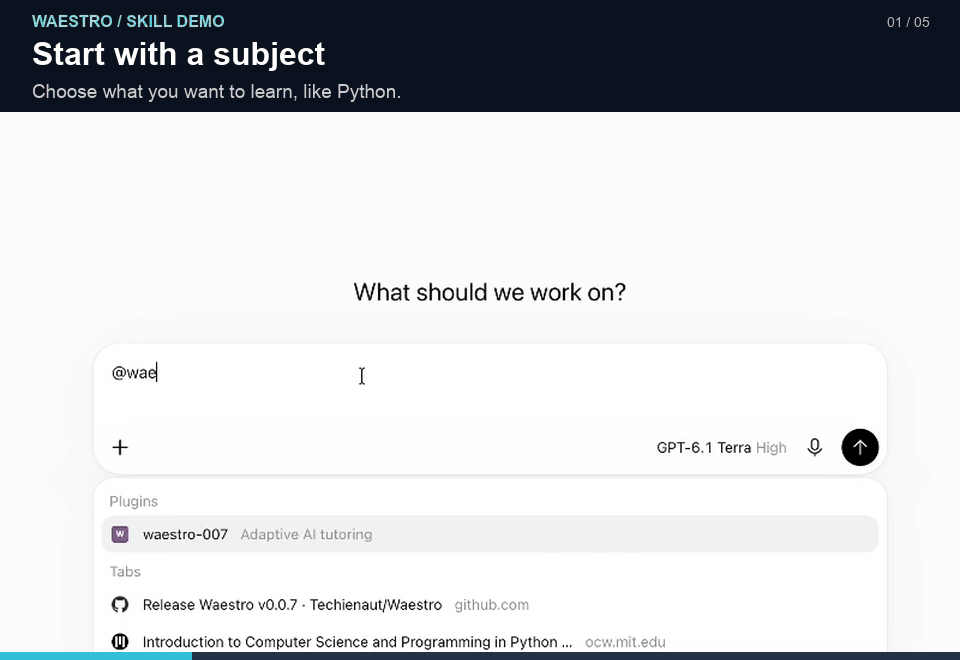

# Waestro

Waestro helps an AI teach you one step at a time. It plans a course, explains small ideas, and gives you practice. Each concept gets exactly one helpful image, which the AI explains using matching labels. Quizzes, homework, and practice use text only. Images focus on your current step, with clear diagrams and useful variety.

## Watch it in action

**28-second preview** · [Watch the full YouTube demo (21 minutes)](https://www.youtube.com/watch?v=Q7Tt1KzbnS4)

The walkthrough shows v0.0.7: setting up the skill, shaping a Python curriculum, learning list comprehensions, and requesting projects. The skill continues to change; use the current instructions in this repository for its latest behavior. Setup and available tools depend on your AI app.

## Set it up

1. [Download the ZIP file](https://github.com/Techienaut/Waestro/archive/refs/heads/main.zip) and unzip it. Keep its files together.
2. If your AI app supports skills, add the whole folder as a skill. If it supports file uploads instead, attach [SKILL.md](SKILL.md), all files in `references/`, and [resume-card-template.md](resume-card-template.md).
3. Start a chat and ask the AI to use Waestro, as shown below.

The AI needs to read the files. If it cannot open them, paste their text when asked. The GIF in `docs/media/` is documentation only and can be left out of your skill upload.

## Example: learn Python

Paste this into your chat:

> Use Waestro to teach me Python. I am a beginner and can study five hours a week. Make a course plan first. Then teach me one small step at a time.

Read the plan. When you are ready, say:

> Start the first lesson.

During a lesson, you can say “Go slower,” “Use simpler words,” or “Show another example.”

## Shape the course before you start

Tell Waestro your goal, experience, available study time, and preferred difficulty. You can learn subjects beyond programming. If you skip the setup questions, ask it to state its assumptions before planning. The current full-course starting estimate is 16 weeks at 20 hours a week; your goals, workload, and subject coverage can change that plan.

Ask to see the complete plan before starting lessons:

> Show the entire curriculum, including every week, section, and module, with outcomes, instructional parts, time estimates, homework, and project plans. Wait for me to review it before teaching.

Check for missing topics, unnecessary repetition, and a realistic workload. You can ask for a harder course, a focused refresher, or a plan based on a syllabus you supply. For example:

> Make this Python course more challenging. Include list comprehensions, reduce repetition, and preserve the agreed topic coverage and study time. Explain any tradeoffs before changing the plan.

For a fresh start rather than continuing an earlier course, say:

> Start a new course. Do not use my previous course records or personal memory to choose its content; use only the goals and background I give you here.

## Learn, check, and practice

Lessons use short explanations, analogies, examples, and diagrams narrated with matching labels. Knowledge checks ask you to explain or apply an idea and receive feedback. You can steer the lesson at any time:

- **Another explanation:** “Explain list comprehensions using grocery prices as a real-world example.”
- **More depth:** “Explain why this works and show a case where it would fail.”
- **A different pace:** “Go slower,” “Make this more challenging,” or “Give me a focused review.”
- **Navigation:** “Go to the module on list comprehensions,” then “Back to the course” when you finish the detour.

“Skip” skips the current question or smallest activity; name a module explicitly if you want to move past the whole module. Skipped work stays unassessed and does not count as mastery or completion.

The course includes module homework, projects, and assessments. Continuing projects can grow through milestones as you learn more. For programming, ask for a practical assignment with a clear goal and starter code:

> Give me a challenging real-world project using the concepts taught so far. Provide a starter file with TODOs where I write the code and tests for normal and edge cases. Show it in one code block and leave the implementation for me.

The demo shows a grocery-order project and a command-line expense-tracker capstone. Those are examples, not fixed assignments for every course. Ask for milestones and feedback as you build; generated starter code and passing supplied tests alone do not establish independent competence.

## Stop and come back

Before you stop, say:

> Pause. Give me my course plan and a progress record, including my next task.

Save or copy both. In a new chat, load Waestro the same way and share your plan and progress record. Then say:

> Continue my course from this record.

Waestro is an experimental alpha and still needs feedback and steering. What it can do depends on your AI app and model; image generation, code execution, and saving files depend on the tools available in your session.

## Give feedback or contribute

Tell us what you expected, what happened, and which course or task exposed the problem. Use synthetic or anonymized examples. As discussed in the video, trying a proposed teaching change on a different subject can help reveal whether it generalizes. Follow the current [contribution process](CONTRIBUTING.md), including maintainer approval before contribution work or opening a pull request.

[Help improve Waestro](CONTRIBUTING.md) · [Report a security issue](SECURITY.md)

License: [AGPL-3.0-only](LICENSE.txt). See [notices](NOTICE.txt).
